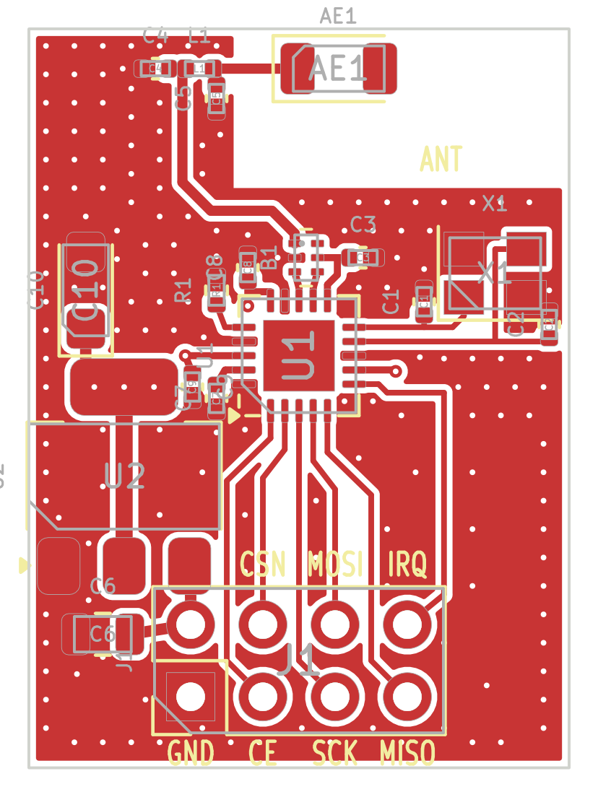

# NRF24DN — nRF24L01+ minimal modül, hazır balun-filtre + AMS1117-3.3, 19 × 26 mm (rev A, 2026-10-27)

## Özet

| | |
|---|---|
| Alıcı-verici | Nordic nRF24L01+ (QFN-20 4×4), 16 MHz kristal |
| Balun + filtre | Johanson **2450BM14A0002** (0603, 6 uç): nRF24'e empedans eşli balun + harmonik filtre, tek parça |
| Anten | Johanson 2450AT18A100E chip anten, pi eşleştirme yeri (C4 / L1 / C5) |
| Besleme | **AMS1117-3.3** (SOT-223) — giriş VIN 4.5…12 V, çıkış +3V3 |
| Bağlantı | 2×4, 2.54 mm başlık — nRF24L01 modül dizilimi, **ancak pin 2 = VIN (5 V)** |
| Kart | 4 katman, 1.6 mm, JLC04161H-7628 yığını, ENIG; 18 parça (2 DNP) |



## Blok yapısı

```
SPI ─ nRF24L01+ ─ ANT2/ANT1 ─ B1 2450BM14 (balun + LPF) ─ C4/L1/C5 pi eşl. ─ chip anten
                  VDD_PA ──── B1.5 (DC besleme) + C3 2.2 nF
VIN (başlık pin 2) ─ AMS1117-3.3 (C6 giriş, C10 tantal çıkış) ─ +3V3 (In2 düzlemi)
```

* **Balun-filtre:** Johanson'un nRF24L01 referansı birebir: ANT2 → 3, ANT1 → 4, VDD_PA → 5 (DC besleme; C3 2.2 nF ile RF toprak), 2 → GND, 1 → 50 Ω çıkış, 6 boş.
  Nordic'in ayrık L/C ağı (L1–L3, C3–C6) yok; ANT1/ANT2 hatları simetrik, ~0.6 mm.
  2025 tarihli veri sayfası C3 için 22 nF yazıyor; 2009 uygulama notu ve Nordic referansı 2.2 nF. 2.2 nF seçildi, ikisi de olur.
* **Parça yönü:** bordo işaret üstte, pin 1 işaretin yanında (dengesiz uç antene bakar, dengeli uçlar 3/4 nRF'ye). Montaj dosyasında F.Fab'deki nokta pin 1'i gösterir.
* **AMS1117:** düşüm ~1.1 V → VIN ≥ 4.5 V. C10 tantal (ESR gerekli; yalnız seramik çıkışta osilasyon riski). Tırnak +3V3, üç via ile In2 düzlemine.
* **Yerleşim:** U2 nRF'nin solunda, VIN ucu başlığın VIN pininin hemen üstünde (yol ~1 mm, üst katman). C6 girişte, C10 tırnağın üstünde.
  Alt grup (nRF, kristal, balun, başlık) önceki 19 × 34 sürüme göre 8 mm yukarı alındı; RF hattı balun → anten ~6 mm.

## Pin başlığı (üstten bakış, anten yukarıda)

```
 VIN  CSN  MOSI  IRQ      <- üst sıra (çift pinler)
 GND  CE   SCK   MISO     <- alt sıra (tek pinler, pin 1 kare pad)
```

**Uyarı:** Standart nRF24L01 modüllerinde pin 2 = 3.3 V'tur. Bu kartta pin 2 regülatör girişidir; 3.3 V verilirse nRF ~2.2 V ile çalışır (sınırda). 5 V'luk soket / adaptör içindir.
Üst serigrafide "VIN" yazısı yok (yerinde U2 ucu var); alt serigrafide tüm pin adları yazılı.

## Stackup ve RF hatları

* L1 sinyal/RF · L2 (In1) kesintisiz GND · L3 (In2) +3V3 düzlemi · L4 GND.
* 50 Ω: **CPWG, iz 0.36 mm, boşluk 0.20 mm**, referans In1 (B1.1 → anten, ~6 mm).
* Anten bölgesi (x ≥ 7.2 mm, y ≤ 5.6 mm) tüm katmanlarda bakırsız (önceki tasarımlarla aynı Johanson yerleşimi).

## Denetim durumu

* ERC: 0 · netlist (şema ↔ tablo): 65/65 pin uyumlu
* DRC: 0 hata, 0 bağlantısız, 0 şema-PCB uyumsuzluğu; 5 serigrafi uyarısı (footprint çizgisi pad / kart kenarına değiyor, üretimde kırpılır)

## Kartta doğrulanması gerekenler (henüz test edilmedi)

1. **Balun yönü:** ilk montajda B1'in bordo işaretinin pin 1 tarafında olduğu kontrol edilmeli (veri sayfası çiziminde görünüm adı belirsiz; uygulama notu "işaret üstte" diyor).
2. **Anten eşleştirme:** C4/L1/C5 değerleri kartta VNA ile ayarlanmalı.
3. **Harmonikler:** B1 2fo/3fo ≥ 15 dB; nRF 0 dBm çıkışta CE-RED sınırı rahat beklenir, spektrumla doğrulanmalı.
4. **Kristal:** CL = 12 pF, C1/C2 = 22 pF; frekans hatası ölçülmeli.
5. **AMS1117 kararlılığı:** C10 tantal; yük basamağında (TX açılış) çıkış osiloskopla bakılmalı.

## Dosyalar ve yeniden üretim

Tasarımın tek kaynağı `tools/parts.py` ve `tools/routes.py`; şema ve PCB bu tablolardan üretilir.

```
python tools/build.py          # şema → ERC → netlist kontrol → PCB → döküm → DRC → uretim/
python tools/build.py --nofab  # yalnız tasarım + denetimler
```

## Kaynaklar

* [Johanson 2450BM14A0002001T veri sayfası](https://www.johansontechnology.com/docs/4805/IPD-2450BM14A0002001T.pdf) — uç dizilimi, yerleşim
* [Johanson 2450BM14A0002 nRF24L01 uygulama notu](https://johansontechnology.com/docs/6/Johanson-2450BM14A0002-App-Note-for-nRF24L01.pdf) — referans şema (ANT2→3, ANT1→4, VDD_PA→5)
* [nRF24L01+ Product Specification v1.0](https://cdn.sparkfun.com/assets/3/d/8/5/1/nRF24L01P_Product_Specification_1_0.pdf)
