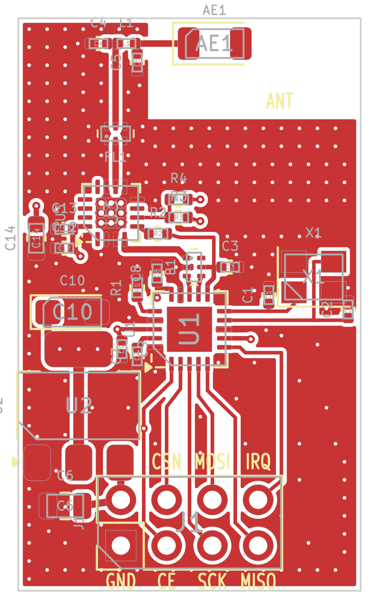

# NRF24DP — nRF24L01+ PA/LNA modülü, hazır balun-filtre + LPF + AMS1117-3.3, 19 × 31.75 mm (rev A, 2026-10-27)

## Özet

| | |
|---|---|
| Alıcı-verici | Nordic nRF24L01+ (QFN-20 4×4), 16 MHz kristal |
| Balun + filtre | Johanson **2450BM14A0002** (0603): nRF24'e eşli balun + harmonik filtre, Nordic'in ayrık L/C ağı yerine |
| PA / LNA | Skyworks RFX2401C (QFN-16 3×3) — +22 dBm doyma, LNA 12 dB. Pin uyumlu muadil: AT2401C |
| PA çıkış filtresi | Johanson **2450LP14A100E** seramik LPF (2fo ≥ 25 dB, 3fo ≥ 18 dB) |
| Anten | Johanson 2450AT18A100E chip anten, pi eşleştirme yeri (C4 / L1 / C5) |
| Besleme | **AMS1117-3.3** (SOT-223), VIN 4.5…6 V önerilir |
| Bağlantı | 2×4, 2.54 mm başlık — nRF24L01 modül dizilimi, **ancak pin 2 = VIN (5 V)** |
| Kart | 4 katman, 1.6 mm, JLC04161H-7628 yığını, ENIG; 26 parça (3 DNP) |



## Blok yapısı

```
SPI ─ nRF24L01+ ─ ANT2/ANT1 ─ B1 2450BM14 ─ RF_TRX 50 Ω ─ U3 RFX2401C ─ FL1 2450LP14 ─ C4/L1/C5 ─ chip anten
                  VDD_PA ──── B1.5 (DC besleme) + C3 2.2 nF
                  VDD_PA ──── R2 ─ TXEN        CE ─ R3 ─ RXEN  (R4 DNP: RXEN sürekli açık)
VIN (başlık pin 2) ─ AMS1117-3.3 (C6 giriş, C10 tantal çıkış) ─ +3V3 (In2 düzlemi)
```

* **nRF → 50 Ω:** hazır balun (Johanson nRF24L01 referansı): ANT2 → 3, ANT1 → 4, VDD_PA → 5 + C3, 1 → RFX TXRX.
* **PA kontrolü:** NRF24PL ile aynı. `TXEN ← VDD_PA` (R2; nRF yalnız TX'te VDD_PA'yı 1.8 V yapar). `RXEN ← CE` (R3): RX'te LNA açık, CE=0'da RFX kapalı.
* **PA bölümü yerleşimi** (RFX, C12–C14, R2–R4, FL1, anten) NRF24PL'deki konumların aynısı. nRF / balun / başlık grubu 2.25 mm yukarıda, AMS1117 nRF'nin solunda (NRF24DN gibi).

## Besleme ve ısı

* TX tepe akımı ~130 mA (RFX + nRF). AMS1117 kaybı = (VIN − 3.3) × I: 5 V'ta ~0.22 W, 12 V'ta ~1.1 W.
  Bu kartta SOT-223 tırnağının bakır alanı küçük; **VIN 4.5…6 V önerilir**. Sürekli TX'te 12 V kullanılmamalı.
* C10 tantal (AMS1117 ESR ister). RFX beslemesinde C12 1 µF / C13 220 pF / C14 10 µF yerinde.

## Pin başlığı (üstten bakış, anten yukarıda)

```
 VIN  CSN  MOSI  IRQ      <- üst sıra (çift pinler)
 GND  CE   SCK   MISO     <- alt sıra (tek pinler, pin 1 kare pad)
```

**Uyarı:** Standart modüllerde pin 2 = 3.3 V'tur; bu kartta regülatör girişidir. Üst serigrafide "VIN" yazısı yok (yerinde U2 ucu var); alt serigrafide tüm pin adları yazılı.
**5 V MCU:** CE 5 V sürülürse RXEN (maks. 3.6 V) aşılır → R3 takılmaz, R4 takılır.

## Stackup ve RF hatları

* L1 sinyal/RF · L2 (In1) kesintisiz GND · L3 (In2) +3V3 düzlemi · L4 GND + CE hattı (R3'e).
* 50 Ω: **CPWG, iz 0.36 mm, boşluk 0.20 mm**, referans In1. RF_TRX (balun → RFX) ~4 mm, RF_ANT ~2 mm.
* Anten bölgesi (x ≥ 7.2 mm, y ≤ 5.6 mm) tüm katmanlarda bakırsız.

## Denetim durumu

* ERC: 0 · netlist (şema ↔ tablo): 94/94 pin uyumlu
* DRC: 0 hata, 0 bağlantısız, 0 şema-PCB uyumsuzluğu; 6 serigrafi uyarısı (footprint çizgisi pad / kart kenarına değiyor, üretimde kırpılır)

## Kartta doğrulanması gerekenler (henüz test edilmedi)

1. **Balun yönü:** B1'in bordo işareti pin 1 tarafında olmalı (veri sayfası çiziminde görünüm adı belirsiz).
2. **Anten eşleştirme:** C4/L1/C5 VNA ile ayarlanmalı.
3. **Harmonikler / CE-RED:** filtre sonrası spektrum ölçülmeli. Çıkış gücü yasal sınır için yazılımda `RF_PWR` ile düşürülmeli (EIRP 20 dBm).
4. **Kristal:** CL = 12 pF, C1/C2 = 22 pF; frekans hatası ölçülmeli.
5. **AMS1117:** TX açılışında çıkış dalgalanması ve 5 V'ta tırnak sıcaklığı ölçülmeli.

## Dosyalar ve yeniden üretim

Tasarımın tek kaynağı `tools/parts.py` ve `tools/routes.py`; şema ve PCB bu tablolardan üretilir.

```
python tools/build.py          # şema → ERC → netlist kontrol → PCB → döküm → DRC → uretim/
python tools/build.py --nofab  # yalnız tasarım + denetimler
```

## Kaynaklar

* [Johanson 2450BM14A0002001T veri sayfası](https://www.johansontechnology.com/docs/4805/IPD-2450BM14A0002001T.pdf)
* [Johanson 2450BM14A0002 nRF24L01 uygulama notu](https://johansontechnology.com/docs/6/Johanson-2450BM14A0002-App-Note-for-nRF24L01.pdf)
* [RFX2401C veri sayfası 204359C](https://www.skyworksinc.com/-/media/SkyWorks/Documents/Products/2301-2400/RFX2401C_204359C.pdf)
* [nRF24L01+ Product Specification v1.0](https://cdn.sparkfun.com/assets/3/d/8/5/1/nRF24L01P_Product_Specification_1_0.pdf)
