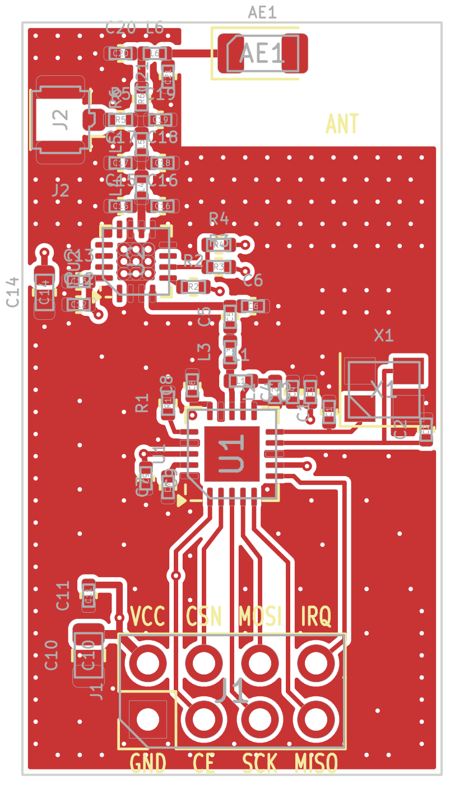

# NRF24PA — nRF24L01+ PA/LNA modülü, 19 × 34 mm (rev A, 2026-10-27)

## Özet

| | |
|---|---|
| Alıcı-verici | Nordic nRF24L01+ (QFN-20 4×4), 16 MHz kristal |
| PA / LNA | Skyworks RFX2401C (QFN-16 3×3) — +22 dBm doyma, LNA 12 dB / NF 2.5 dB. Pin uyumlu muadil: AT2401C |
| Anten | Johanson 2450AT18A100E chip anten **veya** Hirose U.FL (0 Ω ile seçim) |
| Bağlantı | 2×4, 2.54 mm başlık — standart nRF24L01 modül pin dizilimi |
| Besleme | 1.9–3.6 V (tipik 3.3 V), TX tepe ≈ 130 mA |
| Kart | 4 katman, 1.6 mm, JLC04161H-7628 yığını, ENIG |



## Blok yapısı

```
SPI ─ nRF24L01+ ─ L1/L2/L3/C3..C6 ─ RFX2401C ─ harmonik filtre ─┬─ R6 (0R) ─ pi eşl. (C20/L6/C21) ─ chip anten
       (Nordic Fig.32)    50 Ω      TXRX   ANT  (C15..C19,L4,L5) └─ R5 (DNP) ─ U.FL
```

* **nRF → 50 Ω:** Nordic PS v1.0 Şekil 32 / Tablo 29 değerleri birebir. EP (pad 21) Nordic önerisiyle bağlı değil.
* **PA kontrolü:** `TXEN ← VDD_PA` (R2 10k; nRF yalnız TX'te VDD_PA'yı 1.8 V yapar, RFX eşiği 1.2 V).
  `RXEN ← CE` (R3 10k): RX modunda CE=1 → LNA açık; standby/power-down'da CE=0 → RFX kapalı (~µA).
* **Harmonik filtre:** Skyworks referansı "Opsiyon 1" (ayrık pi LC). C15 (0.3 pF) ANT pinine en yakın.

## Anten seçimi (montajda)

| Kullanım | R6 | R5 | L6 | C20 / C21 |
|---|---|---|---|---|
| Chip anten (varsayılan) | 0R | — | 0R (ayarla nH) | DNP (ayarla) |
| U.FL harici anten | — | 0R | önemsiz | — |

## Stackup ve RF hatları

* L1 sinyal/RF · L2 (In1) kesintisiz GND · L3 (In2) +3V3 düzlemi · L4 GND + CE / VDD_PA kontrol hatları.
* 50 Ω: **CPWG, iz 0.36 mm, boşluk 0.20 mm**, referans In1 (prepreg 0.2104 mm, εr 4.4) → hesap ≈ 50–51 Ω.
  Üretimde başka yığın seçilirse iz genişliği yeniden hesaplanmalı.
* Anten bölgesi (x ≥ 7.2 mm, y ≤ 5.6 mm) tüm katmanlarda bakırsız; anten besleme ucu toprak kenarından ~1.6 mm (Johanson yerleşimi).
* RF bölgesinde 1 mm, iç bölgede 2 mm aralıklı GND dikiş via'ları; RFX EP'de 9 termal via.

## Pin başlığı (üstten bakış, anten yukarıda)

```
 VCC  CSN  MOSI  IRQ      <- üst sıra (çift pinler)
 GND  CE   SCK   MISO     <- alt sıra (tek pinler, pin 1 kare pad)
```
Pin adları üst ve alt serigrafide yazılı. Mevcut bir kartın soketine takılacaksa dizilimi o kartın soketiyle karşılaştırın.

## Denetim durumu

* ERC: 0 · netlist (şema ↔ tablo): 112/112 pin uyumlu
* DRC: 0 hata, 0 bağlantısız, 0 şema-PCB uyumsuzluğu; 6 serigrafi uyarısı (footprint silk çizgisi pad'e değiyor, üretimde maske kırpar)
* Bilinçli kapatılan kurallar (`.kicad_pro`): `courtyards_overlap` (RF 0402 ağı referans tasarımlardaki gibi sık), `lib_footprint_mismatch` (U.FL footprint'i 180° döndürülmüş)

## Kartta doğrulanması gerekenler (henüz test edilmedi)

1. **Anten eşleştirme:** C20/L6/C21 değerleri kartta VNA ile ayarlanmalı (Johanson: değerler kart yerleşimine özgü).
2. **Harmonikler / CE-RED / FCC:** RFX2401C 2. harmonik −10 dBm/MHz (veri sayfası) — filtre sonrası spektrum ölçülmeli; gerekirse L4/L5/C16–C19 ince ayar veya seramik LPF (Johanson 2450LP14A100) seçeneği.
3. **5 V MCU:** CE 5 V sürülürse RXEN pini (maks. 3.6 V) aşılır → R3 takılmaz, R4 takılır (LNA sürekli açık; power-down'da da RFX RX akımı çekilir).
4. **Kristal:** CL = 12 pF, ±20 ppm; C1/C2 = 22 pF (2·CL − Cpcb − Cpin). Frekans hatası ölçülüp gerekirse C1/C2 ayarlanmalı.
5. **Çıkış gücü:** nRF 0 dBm → PA doymada (~+20…22 dBm). Yasal sınır için yazılımda `RF_PWR` düşürülmeli (EIRP 20 dBm).

## Dosyalar ve yeniden üretim

Tasarımın tek kaynağı `tools/parts.py` (parça / net / konum tablosu) ve `tools/routes.py` (yollar).
Şema ve PCB bu tablolardan üretilir; KiCad'de elle yapılan değişiklik bir sonraki üretimde kaybolur
— kalıcı değişiklik tabloya yazılmalı **ya da** üretici bırakılıp KiCad'de elle devam edilmeli.

```
python tools/build.py          # şema → ERC → netlist kontrol → PCB → döküm → DRC → uretim/
python tools/build.py --nofab  # yalnız tasarım + denetimler
```

| Yol | İçerik |
|---|---|
| `kicad/` | KiCad 9 projesi (`NRF24PA.kicad_pro/_sch/_pcb`, `elf_rf.kicad_sym` RFX2401C sembolü) |
| `uretim/gerber/` | Gerber (4 katman) + Excellon + delik haritası + job dosyası |
| `uretim/` | BOM (csv), dizgi dosyası (sol-alt köşe orijinli), şema PDF, montaj PDF, STEP |
| `tools/` | Üreteçler (`gen_sch.py`, `gen_pcb.py`, `fill.py`, `check_net.py`, `render.py`, `build.py`) |

## Kaynaklar

* [nRF24L01+ Product Specification v1.0](https://cdn.sparkfun.com/assets/3/d/8/5/1/nRF24L01P_Product_Specification_1_0.pdf) — Şekil 32, Tablo 29
* [RFX2401C veri sayfası 204359C](https://www.skyworksinc.com/-/media/SkyWorks/Documents/Products/2301-2400/RFX2401C_204359C.pdf) — Tablo 6, Şekil 3
* [Johanson 2450AT18A100E](https://www.johansontechnology.com/datasheets/2450AT18A100/2450AT18A100.pdf) — montaj ölçüleri
